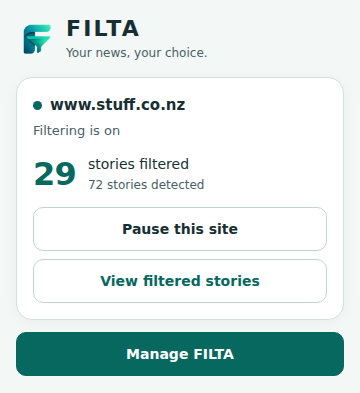
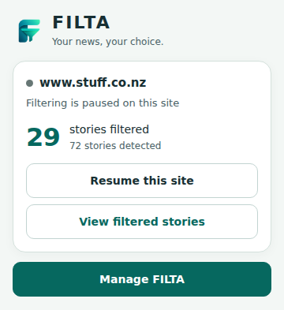

# FILTA 0.2.0 development 2 — implementation and validation

22 October 2026. Continues existing draft PR #1; no merge or Chrome Web Store publication.

## Changes

- A delimited disclosure at the start of a headline (for example `SPONSORED:`, `[Paid content]`, `Advertorial |`) is strong, explainable evidence. Incidental sponsorship reporting, undelimited words and quoted disclosures remain conservative. The rule is declarative and publisher independent.
- Discovery separates story destinations from taxonomy/profile URLs, visible metadata links and secondary regions. Complete single-story boundaries remain required; navigation, controls, reading views, ads and ambiguous multi-story collections stay protected.
- A promotional editorial wrapper or a `with-byline` layout flag no longer suppresses all its cards. Actual byline regions remain excluded. Short labels in card-owned data attributes are extracted, including delayed labels. False/hidden labels and adjacent story/ad text do not bleed into classification.
- Changes to roles, protection attributes and inert content now trigger rescanning/restoration. Debug story review includes extracted fields alongside scores, decisions and detector identity.
- The popup has a scoped stylesheet, original logo, compact count, full accessible hostname with visual ellipsis, short actions, explicit startup/save failures and all existing controls. Settings/onboarding source and design are unchanged. `version_name` identifies this build as **0.2.0 development 2**.

## Exact Stuff diagnosis

Read-only inspection of the owner's already-open, rendered `https://www.stuff.co.nz/life-and-style` tab in the connected **Brave** browser established that both reported cards remained visible (`display:flex`). Four actual article elements were captured unchanged, wrapped in neutral fixture scaffolding. No publisher navigation, script injection or preference changes were performed in that browser.

| Card | Baseline b41b5c2 | Development 2 |
| --- | --- | --- |
| SPONSORED: The afterparty is the main event this year | Detected, exact headline, sponsored score **1**, allow | Detected, score **5**, collapse/hide |
| SPONSORED: The forest Dilmah is fighting to save | Detected, exact headline, sponsored score **1**, allow | Detected, score **5**, collapse/hide |
| Butter, sauce or milk: What cafe extra do you resent paying for? | Score 0, allow | Score 0, allow |
| ‘Pre-loved house’ for $195k and a lot of sweat equity makes a great first home | Score 0, allow | Score 0, allow |

The sponsored threshold is **4**. Baseline extraction succeeds for these two cards; classification is the confirmed failure in the captured DOM. Replay verifies preferences, both renderer modes, always-show and global pause. This does not prove that every other missed card failed at the same stage. Broader discovery/metadata failures were separately reproduced in controlled structures and fixed generally. No hardcoded headline or Stuff adapter is involved.

[Exact fields and before/after traces](dev2/stuff-before-after.json) · [Rendered DOM fixture](../../tests/fixtures/publishers/stuff-owner-rendered.html)

## Verified results

- **176 passing automated tests: 65 core + 111 browser**, including enclosing tests. `npm run check` passes strict TypeScript, production build, tests and package audit. [Successful check log](dev2/check.log).
- Existing 140-case controlled all-category challenge passes. All 14 categories also pass through extraction, decisions and both rendering modes in **five controlled layout families (70 cards)**. Selecting only Sport leaves other cards visible.
- **25 publishers' previously captured snippets** pass detection and full-card rendering, show-once restoration, neighbour isolation and global pause. This isolates rendering with a blocked URL; it does not test semantic accuracy. External resources are aborted; publisher CSS is absent, so snippet restoration invokes the real button handler programmatically. Full UI suites separately test pointer and keyboard interactions. [Results](dev2/publisher-rendering.json).
- Exact rendered Stuff capture and retained BBC owner-card regressions pass. Controlled positive/negative tests cover promotional wrappers, secondary links, delayed metadata, false and hidden flags, changed roles and recycled cards.
- Popup normal states have no horizontal/vertical overflow at **360 × 520 CSS px**; buttons remain single-line and at least **44 px** high. Active popup is **392.375 px** tall; opt-in detection state is **444.375 px**. Narrow width and 200% text have no horizontal clipping; enlarged text may require vertical scrolling. [Measurements](dev2/popup-layout.json).
- Tested axe WCAG A/AA rules report zero violations; keyboard order and reduced-motion checks pass. This is not complete accessibility certification.
- 600 controlled cards detected in about **157 ms** in this environment. [Timing](dev2/performance.json).
- `npm audit`: **zero vulnerabilities**. No new dependencies, permissions or network behaviour. Original PNG hashes and dimensions pass the existing audit. Preference/storage schema and identity inputs are unchanged.
- `npm run package` passes. **15 ZIP entries** pass CRC and match `dist/` byte-for-byte; manifest at ZIP root. ZIP size **64,938 bytes**. SHA-256: `493d509c0a8af9e5709b7e25261a502c1cc11ff04763eaac46e2c9f6af7cbeb3`.

## Screenshots

These are the real production popup HTML/CSS/JavaScript rendered in Chromium **153**, using the simulated WebExtension API. The 29/72 example is simulated state, not a new live Stuff count or a native toolbar screenshot.

| Active, 360 px | Paused, 360 px |
| --- | --- |
|  |  |

[200% text at desktop width](popup-dev2/desktop-200-percent.png) · [Narrow width + 200% text](popup-dev2/narrow-200-percent.png) · [All 13 state screenshots](popup-dev2/)

## Unverified and remaining limits

- The updated build has **not** been installed in the owner's live browser. Live observation of the existing failure plus exact rendered-DOM replay is distinct from a live fix retest.
- Native MV3 test attempted with lightweight Chromium 153: **timed out waiting for the extension service worker**. Native Chrome installation, toolbar sizing/interaction, real icon presentation and same-identity upgrade remain owner checks. The connected browser blocks extension-page inspection; that restriction was respected.
- Standard Playwright Chrome download failed (invalid/truncated archive), so the test browser came from a temporary, external-to-repository `@sparticuz/chromium` runtime. No browser/runtime package was added to FILTA dependencies.
- Rule-based semantic limits remain. The existing 28-headline challenge is unchanged at **19 true positives, 0 false positives, 6 false negatives, 3 true negatives**. Those misses include opaque names and missing context; no names were added to chase them. [Results](dev2/real-headline-holdout.json). Neither this small set nor controlled fixtures establish universal accuracy.

## Install the development ZIP

1. Download **FILTA-0.2.0-dev2.zip** and extract it to a permanent folder.
2. In Chrome open `chrome://extensions`, enable **Developer mode**, then choose **Load unpacked** and select the folder containing `manifest.json`.
3. If replacing an existing unpacked copy, point that copy at the extracted files and reload it. Avoid running two FILTA copies at once. Store and unpacked copies may have separate storage; preserve existing preferences before disabling the old copy.
4. Check the extension details show **0.2.0 development 2**. Select the intended topics, refresh publisher pages, and retest the two sponsored cards in Collapse and Hide.
5. Check pause/resume, review/Show story and Manage FILTA in the actual toolbar. Record the build label, selected topics, page URL and any missed card in owner feedback. Do not publish this test build.

Build again with `npm ci && npm run package`; set `CHROMIUM_PATH` to a compatible local browser when the standard Playwright runtime is unavailable.
